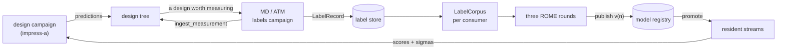

# ASD surrogates

> Every other example here learns from the campaign's **own outputs**. This one
> learns from **measured physics** — MD and alchemical free-energy labels that
> cost GPU-hours each and arrive from a different campaign — and serves three
> models back into the one that produced the designs.

Source: `examples/impress/small_molecule_binding/`. Entry point:
`run_asd_surrogates_rome.py`.

!!! note "Two directories called `small_molecule_binding`"

    IMPRESS's own `examples/small_molecule_binding/` is the design pipeline
    ([Running IMPRESS](../impress.md)). This is `examples/impress/small_molecule_binding/`
    inside ROME, and it holds no pipeline at all — it is the surrogate half of
    an autoagent-steered-diffusion campaign, and the pipeline runs beside it.

## What is different about this one

The other integrations here are one loop: a campaign produces scored outputs, a
trainer improves the thing that produced them, the improved thing goes back in.
Everything the trainer learns from is the campaign's own.

This one has two loops at different speeds, and the slow one is the point.



A measured label does two things from one write: it **supersedes** the
prediction in the design tree, and it becomes a corpus row. One result, two
consumers, written once — two writers would be two chances to disagree about a
number that cost three to eight GPU-hours, and the disagreement would be
invisible because both sides would keep working.

The surrogates are therefore **not** trained on what the campaign thought. They
are trained on what a physics engine measured, and the gap between those two is
what they exist to close.

## The three models

| | Model | Predicts | Fit | Resident from |
| --- | --- | --- | --- | --- |
| **A** | `lig_anchor` | which ligand heavy atoms are worth anchoring | online reward head over a frozen encoder | M4 |
| **B** | `pocket_preorg` | apo-state preorganisation — pocket Cα RMSD, rotamer entropy, ligand RMSF | five-member deep ensemble, heteroscedastic Gaussian NLL | **M2** |
| **C** | `aff_delta` | a correction to a co-folding model's own affinity, with a calibrated σ | GP recalibrated against a frozen offline residual | M4 |

**B is the one that has to be resident**, because B is the FK potential: it is
called once per particle per resampling event, roughly 45 times per trajectory.
A and C are scored per design, which a task can afford until their call rate
justifies a permanently held slot — residency costs one concurrent-task slot for
the whole campaign, and the measured ceiling is 32 workers on a whole
`gpuA100x4` node. `streams.RESIDENT_FROM` is where that dial lives, so the
default is a decision rather than an accident.

**A regresses action against outcome, and that is not a detail.** Its target is
what happened *downstream* of an anchor set — a physics label, or B's or C's
reading of the design the anchor set produced — never a property of the anchor
set itself. `ANCHOR_OWN_METRICS` refuses the latter mechanically, by the same
rule the [interface-targeting](interface-targeting.md#why-not-train-on-the-designed-burial)
example arrived at the hard way: a model fitted on its own instruction's
compliance converges to its initial condition while reporting a plausible error.

**C reads its prior and never rewrites it — including the PCA basis.** Ten to
twenty in-house labels *recalibrate* a GP against a residual fitted offline on
public affinity data; re-fitting the projection on ten points would move the
basis the prior was trained in, and the prior would then be evaluated somewhere
it has never seen. The manifest records which residual version the round read,
so a campaign's `v0` is "public residual R, zero in-house labels" rather than an
unlabelled starting point.

## The loop, as code

`run_asd_surrogates_rome.py` drives nothing. It brings up three managers over
one engine and then pumps:

```python
batch = surrogate.corpus.take()                      # select; mark nothing
accepted = surrogate.manager.add_training_batch(batch.rows)
surrogate.corpus.commit(batch)                       # mark exactly this batch
```

**`take` and `commit` are two calls because a round can die between them.** A
crash after `take` leaves every record still owed, which is what a restart
needs when losing one label is a measurable loss; `Consumed.mark` only ever
unions, so a replayed commit is a no-op rather than a double count.

**The corpus is a consumed *set* per consumer, not a watermark.** ROME's
`DataManager` tracks a prefix high-water mark, which can say "taken everything
up to *n*" and nothing else. The selection policy here is rank-based and a
sampler selects a **non-contiguous** subset: advance a mark past it and every
skipped record retires untrained, refuse to advance it and the next round
re-selects the same rows. There is no correct mark value for a sampled batch,
which makes a mark the wrong *structure* rather than a coarser one.
`DataManager` is untouched and is correct for a prefix consumer; this project is
not one.

## Running it

```bash
cd $WORK_DIR/ROME/examples/impress/small_molecule_binding

export ASD_OUTPUT_DIR=$WORK_DIR/asd_campaign_outputs
export ASD_RESIDUAL=$WORK_DIR/residual/residual.json   # C's offline prior
export ITGT_DIR=$WORK_DIR/interface-targeting          # A's encoder stack

dragon -s run_asd_surrogates_rome.py
```

It runs until the stop file appears or `ASD_RUN_SECONDS` elapses, because a
resident surrogate service has no natural end — the design campaign beside it
decides that. With neither set it runs until the allocation does.

| Var | Default | What it does |
| --- | --- | --- |
| `ASD_OUTPUT_DIR` | `campaign_outputs/` | Root for labels, registry and checkpoints. |
| `ASD_LABEL_ROOT` | `$ASD_OUTPUT_DIR/labels` | The label store the design campaign writes to. |
| `ASD_REGISTRY_ROOT` | `$ASD_OUTPUT_DIR/models` | `asteer.registry.ModelRegistry`'s root. |
| `ASD_RESIDUAL` | *unset* | C's offline residual. Without it C's round reports insufficient evidence. |
| `ASD_ENCODER` | *unset* | A's frozen encoder. |
| `ASD_BUFFER` | `$ASD_OUTPUT_DIR/liganchor_replay.jsonl` | A's replay buffer — outside any round's output, so it survives one. |
| `ASD_MIN_SAMPLES_B` / `_C` / `_A` | `20` / `5` / `8` | Unconsumed rows before a round is possible. |
| `ASD_TRAIN_GPUS_B` / `_C` / `_A` | `1` / `0` / `1` | **Quantities, not devices.** C is zero: a GP on twenty points is seconds of CPU. |
| `ASD_STREAM_GPUS` | `0` | A stream task's GPUs. Zero while the featuriser is a width-2 stand-in. |
| `ASD_RUN_SECONDS` | `0` (forever) | Wind down after this long. |
| `ASD_STOP_FILE` | `$ASD_OUTPUT_DIR/STOP` | Touch it to wind down. Not SIGKILL, which loses an in-flight round. |

## The nine modules

| Module | Imports | Role |
| --- | --- | --- |
| [`corpus`][examples.impress.small_molecule_binding.corpus] | **asteer + stdlib** | What each consumer is owed, and what it has taken. |
| [`streams`][examples.impress.small_molecule_binding.streams] | ROME + asteer | Three `StreamConfig`s over one load/process pair, and the client end. |
| [`preorg`][examples.impress.small_molecule_binding.preorg] | ROME only | B's `TrainTask`: validate, write a job, hand over a command. |
| [`affdelta`][examples.impress.small_molecule_binding.affdelta] | ROME only | C's `TrainTask`. |
| [`liganchor`][examples.impress.small_molecule_binding.liganchor] | ROME only | A's `TrainTask`. |
| [`preorg_train_wrapper`][examples.impress.small_molecule_binding.preorg_train_wrapper] | torch | B's round, and the predictor a stream is handed. |
| [`affdelta_train_wrapper`][examples.impress.small_molecule_binding.affdelta_train_wrapper] | torch, botorch | C's round; the GP and the residual. |
| [`liganchor_train_wrapper`][examples.impress.small_molecule_binding.liganchor_train_wrapper] | torch, itgt | A's round, through `itgt`'s own artifact format. |
| [`run_asd_surrogates_rome`][examples.impress.small_molecule_binding.run_asd_surrogates_rome] | ROME, rhapsody | The entry point: one engine, three managers, the pump. |

**Every heavy import in this directory is inside a function.** The driver half
of each model (`preorg`, `affdelta`, `liganchor`) builds a job description and
hands it over; the wrapper owns torch. That is not style: a driver that imports
torch keeps a CUDA context resident in the campaign process for the whole run,
and the campaign process is the one that submits every task. A test asserts it for B's and C's
drivers, and for the entry point, by importing each in a cold subprocess and
looking at `sys.modules`. A's has no such test yet.

## Five things that are load-bearing

**One engine, three managers.** `rome.Manager` holds one trainer and there are
three models. Every manager is handed the runner's engine, which is what makes
`Manager._ensure_asyncflow`'s build-your-own branch unreachable here — and the
engine is also the only place a resource policy can attach, so a second engine
would be a second inventory. Three managers does force three shared
dictionaries: `Manager` namespaces every key under a fixed `rome|` prefix, so
three over one dictionary would collide on `model_path` and B's published
checkpoint would arrive as C's.

**Publishing is not promoting.** A finished round writes `v{N}` with its
held-out metrics and `promoted=False`. Only the controller flips the pointer,
and the controller is phase III of the campaign. A trainer that promoted its own
model would be grading its own homework with the registry as the mark sheet.

**The stream loader reads the promoted pointer and ignores the path ROME hands
it.** ROME's reload fires on *publication* — `trainer.on_checkpoint` is wired to
`stream.on_checkpoint` — and loading what it offers would hot-swap every stream
onto an unvalidated model. So `load_promoted` takes the pointer as its authority
and the handed path as a trigger only: a round that publishes an unpromoted
version re-resolves to the same promoted version and changes nothing anybody is
served.

**A stream with nothing promoted serves nothing and says so.** Every absence
becomes an error payload, which the client turns into `StreamUnavailable`. A
scoring client that received a default on an outage would put a number into the
design tree that looks exactly like a score, gets ranked on, and trains the next
round of the model that was supposed to produce it.

**One featuriser, two callers.** `asteer.features.embed` turns a payload into
the vector B regresses on, and **both** the label bridge and B's stream go
through it — so a corpus row and a score request agree because they share a
function rather than because two copies were kept in step. It uses `hashlib`
rather than `hash()`, because the two callers are usually two processes and
Python salts `hash()` per interpreter.

!!! warning "The featuriser is a declared stand-in"

    `FEATURISER_VERSION` is `"standin-1"` and the vector is two numbers derived
    from a structure's identity. It carries no chemistry. The specification
    names MLP heads on frozen LigandMPNN / co-folding encoder embeddings, and
    getting activations out of a toolkit that shells out to a CLI is a new
    adapter rather than a function call. The version string is on every vector
    so a corpus row written today can be told from one written against a real
    encoder; without it the two would be the same numbers under the same key,
    and the only symptom would be a model that quietly got worse.

## Placement: the application declares a quantity

**No line of code in the runner names a GPU, a host or a node.** Each trainer
declares `gpus` — a count — and the demand handed to the ready-queue policy is
*derived* from that count, so the number is written once. Choosing the device is
the middleware's job: `ResourcePolicy` in `node` mode picks the node and the
devices and writes the choice into the task description.

The node inventory has **one source, and it is the backend**:
`backend.topology()`, which rhapsody fills from the Dragon runtime. A
hand-written `NodeShape` in a runner is the same fact as the submit script's
`--gpus-per-node`, stated again with nothing checking the two agree — and a pool
claiming devices the job did not get does not fail admission, it places a task
onto a device that is not there.

Two things the runner does about that, both worth knowing:

* **It narrows the GPU count by `CUDA_VISIBLE_DEVICES`.** rhapsody fills `gpus`
  from a pynvml probe, and NVML counts the devices the *machine* has rather than
  the ones the job was given.
* **A backend reporting no topology gets no policy**, with the reason printed.
  Inventing an inventory is the failure this is avoiding, not a fallback from it.

!!! warning "The policy does not attach on the released middleware"

    `radical.asyncflow` 0.7.0 has no `policies` module and no `policy` keyword
    on `WorkflowEngine.create`; both are on an unmerged branch. The runner
    reports which of the two is missing and builds the engine without one, which
    is the released middleware's own behaviour — every ready task goes to the
    backend at once and the backend chooses the node. That is a legitimate run.
    It is not the same run, which is why it is said out loud rather than
    silently degraded to.

    A resident stream cannot be placed at all: a stream is an asyncflow
    *service*, and services bypass the policy by design.

## Reading the output

```
[ASD] placement: DragonExecutionBackend.topology() reported no nodes, so there is no
      inventory to build a Pool from...
[ASD] 3 surrogate(s) up; labels from /work/.../asd_campaign_outputs/labels
[ASD] pocket_preorg: +22 of 22 owed
[ASD] done:
  pocket_preorg: corpus 22, 1 round(s), published v1 -> v1
  aff_delta: corpus 0, 0 round(s), published v0
  lig_anchor: corpus 0, 0 round(s), published v0
```

Per campaign output root:

| Path | Contents |
| --- | --- |
| `labels/` | The label store the design campaign writes. One `LabelRecord` per measurement. |
| `labels/consumed/<model_id>.json` | Which label ids that model has taken. |
| `models/<model_id>/v{n}/manifest.json` | The version's held-out metrics, and `promoted`. |
| `models/<model_id>/v{n}/ensemble.pt` | B's weights. C writes `gp.pt` plus a **copy** of `residual.json`; A writes `head/`. |
| `rome_checkpoints/<model_id>/.../job.json` | What the round was asked to fit. |
| `rome_checkpoints/<model_id>/.../metrics.json` | What it measured, plus the version it published. |
| `rome_checkpoints/<model_id>/.../train_complete` | Written last, after the manifest. The manager polls for it. |
| `liganchor_replay.jsonl` | A's `(action, outcome)` pairs, across rounds. |

### What to look at first

`logo_r2` in the manifest, from leave-one-group-out over scaffold clusters.
**Below zero means predicting the campaign's mean beats the model** — and it is
reported rather than suppressed, because negative *is* the finding: it is the
number that catches a self-confirming objective.

Read it beside the **group count**, which the manifest records in `notes` as
`groups=N`. A
five-member ensemble on 20–40 samples with a 20% holdout is judged on roughly
four to eight points, where `logo_r2` is close to meaningless below about four
groups. A manifest with too few groups says *insufficient evidence*; it does not
say *pass*, and the promotion gate treats the two differently.

For C, read the **calibration** term before the error term. A collapsed σ turns
`dg_lcb` — the lower confidence bound the campaign ranks on — into a posterior
mean, and the ranking then stops accounting for uncertainty without anything
looking wrong.

## What does not work yet

| | |
| --- | --- |
| **It has never run.** | The entry point is tested for construction on a laptop, not for a campaign. That needs an allocation. |
| **Only B is served.** | A's head scores bags comparably *within a group only* and reports no σ; C's posterior predicts a correction on the residual's basis, so serving `dg_corrected` is a composition rather than an adapter. Both `build`s raise a named refusal, which the loader turns into an `Unavailable`. `RESIDENT_FROM` already puts both at M4. |
| **C's and A's `property_name` default to the metric.** | A `LabelRecord` carries the property a measurement supersedes (`dg_corrected`), not the metric the tool reported (`dg_abfe`). The entry point reads the mapping and passes the property explicitly; the defaults are still wrong for anyone who does not. |
| **No promotion gate.** | Nothing promotes, so nothing is served, until the controller exists. That is phase III. |
