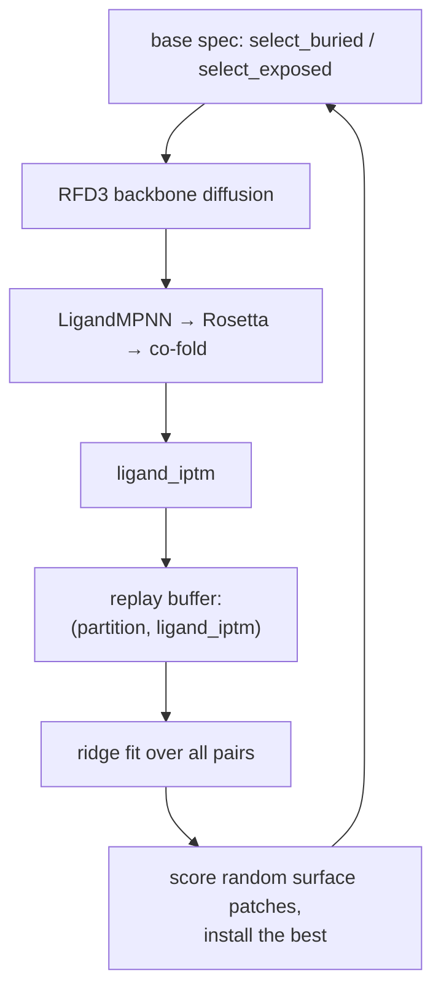

# Interface targeting

> Every other example here improves a **model**. This one improves a model's
> **inputs** — the parameters RFD3's backbone diffusion is conditioned on — and
> leaves every model in the pipeline untouched.

Source: `examples/impress_r/interface_targeting/`.

## What is open loop, and where

IMPRESS's small-molecule pipeline runs RFD3 backbone diffusion → LigandMPNN →
Rosetta refinement → co-folding → confidence gates. Its sibling example,
[`small_molecule_binding`](../impress.md), closes the loop around **stage 2**:
the campaign's best designs fine-tune LigandMPNN and the improved weights return
to the pipeline.

Stage 1 stays open. What parameterizes it is one field group in each pipeline's
base design spec, `p{N}_in/ALR_binder_design.json`:

```json
{"partial": {"input":  "./input_pdbs/scaffold-with-ALR.pdb",
             "ligand": "A:R",
             "length": "70-170",
             "select_exposed": {"A:R": "C13,C14,...,S2"},
             "select_buried":  {"A:R": "C18,C19,...,S1"}}}
```

Those two selections partition the target ligand's 30 heavy atoms into the ones
the binder should be designed to contact and the ones it should not. RFD3 reads
them as a three-bin `rasa_bin` conditioning signal. **They are hand-authored,
and every production small-molecule campaign to date has reused one identical
partition of ligand `A:R`.** It is an unexplored design variable sitting
upstream of everything else in the pipeline.

The models that could propose alternatives live in a separate repository,
`interface-targeting` (package `itgt`) — which ships no trained weights at all,
and whose quality-aware heads had essentially no labels: one real scored target
across sixteen campaigns. This example supplies both halves.

## The loop



Three hooks in `adaptive_decision`, where the sibling has two:

1. **Harvest** — stage the fold complex and add the pass to the ROME corpus.
2. **Pair** — attribute this pass's `ligand_iptm` to the partition it actually
   ran under, and append that pair to the replay buffer.
3. **Apply** — if a newer surrogate has been published, propose a partition and
   install it as this pipeline's base spec.

Hook 2 is what makes it a loop rather than a mirror. See
[Why not train on the designed burial](#why-not-train-on-the-designed-burial).

## Running it

```bash
cd $WORK_DIR/ROME/examples/impress_r

export SBATCH_ACCOUNT=<project>-delta-gpu
export WORK_DIR=/work/nvme/bdyk/$USER
export IMPRESS_USECASE=interface_targeting
export ITGT_DIR=$WORK_DIR/interface-targeting

bash submit.sh
```

It drives the same `SmallMoleculeBindingPipeline` as `small_molecule_binding`, so
it needs the same toolchain — LigandMPNN, Boltz, the RFD3 foundry sandbox — plus
`ITGT_DIR`. An unset or missing `ITGT_DIR` is **not** fatal: the campaign runs
with the hand-authored partition unchanged, which is exactly what the sibling
does today.

| Var | Default | What it does |
| --- | --- | --- |
| `ITGT_DIR` | `$WORK_DIR/interface-targeting` | The checkout supplying the models. |
| `ROME_ITGT_COMPONENT` | `reward_ridge` | `reward_ridge`, `burial_prior` or `trunk`. |
| `ROME_ITGT_CANDIDATES` | `64` | Candidate partitions ranked per proposal. |
| `ROME_ITGT_SIZE_BAND` | `4` | Half-width of the selection-size band. |

## The four modules

| Module | Imports | Role |
| --- | --- | --- |
| [`itgt_spec`][examples.impress_r.interface_targeting.itgt_spec] | **pure stdlib** | Read and patch the RFD3 base spec. |
| [`itgt_trainer`][examples.impress_r.interface_targeting.itgt_trainer] | ROME only | The `TrainTask`: validate, write a job, hand over a command. |
| `itgt_train_wrapper` | itgt, numpy, sklearn | The round itself, as its own process. |
| [`itgt_propose`][examples.impress_r.interface_targeting.itgt_propose] | itgt (lazily) | Propose a partition and install it. |

`itgt_spec` being dependency-free is the main structural decision. Most of this
integration's correctness is in "patch exactly these three fields and nothing
else", so that surface is kept testable with no scientific stack — 31 unit tests
that run in a quarter of a second on a laptop.

## Why not train on the designed burial

The obvious training pair is wrong, and wrong in a way that would not show up in
any metric the round reports.

itgt's per-atom scorers learn `apo ligand features → burial_fraction`, where the
label is the ΔSASA of the ligand inside a designed complex. Fitting that on the
campaign's own designs looks like learning which atoms good binders bury. It is
not: **the binder buried those atoms because the previous round's
`select_buried` told RFD3 to bury them.** The label measures compliance with our
own instruction. `ligand_iptm` would enter only as an admission filter, so
nothing in the objective separates a partition that scored 0.9 from one that
scored 0.4, and the model converges to its own initial condition within about two
rounds while reporting a perfectly plausible training error.

At a single ligand it degenerates further. The proposer featurizes one fixed
30×50 matrix, so the design matrix is near-constant while the labels vary, and a
depth-3 gradient-boosted tree reduces to a per-atom mean over admitted designs —
a thirty-element lookup table wearing a model's clothes.

So the default component regresses **action against outcome** instead:

* **action** — the partition this workflow wrote, in reference atom names
* **outcome** — the `ligand_iptm` of the pass that action produced

Both are clean: the action is ours, the reward is strictly downstream of it. The
pairs accumulate in `itgt.common.corpus.ReplayBuffer`, which is the one piece
itgt built for online training, and which dedupes on `InterfaceTarget.key()` so
re-proposing a scored partition updates it rather than counting it twice.

`burial_prior` and `trunk` remain selectable as a cold-start prior and an
ablation. They are labelled as self-confirming in their own docstrings; do not
read their training error as evidence of anything. `train_baseline` performs no
held-out validation at all.

!!! tip "Failed folds are kept on purpose"

    The pipeline records `best_fold_model` whenever a fold produced a confidence
    file, not only when it passed the gate. A reward regression needs its
    negatives — filtering to good designs truncates the response variable and
    leaves the model unable to distinguish a bad partition from an unobserved
    one. This is why `itgt_corpus_filter`'s thresholds default to **off**, the
    opposite of the sibling's filter, and why the corpus sampler's `fraction`
    defaults to `1.0`.

## Four details that are load-bearing

**The spec is patched, never regenerated.** The pipeline's guided-diffusion path
indexes the spec by entry name (`base['partial']`) and copies its fields
verbatim. `itgt.workflow.small_molecule_binding.write_campaign_inputs` would
rewrite `input_pdbs/` and collapse that entry name, so it is not used here. Only
the three rASA fields are replaced; `input`, `length`, `ligand` and the entry
name survive byte-identically. The decisive test is that patching with the
template's *own* partition reproduces the template exactly.

**Patching is always from a pristine snapshot.** `.itgt/template.json` is
captured once, so round *n*'s partition is a function of the model and the
original template — proposals cannot compound.

**Selection size is banded, not floored.** Mean-pooled features have a
small-patch bias: the average chemistry of four well-chosen atoms beats that of
fourteen. Left unbanded, the argmax collapses onto `min_atoms`, and a four-atom
buried patch is not an interface. Both bounds are derived from the template's own
selection size ± `ROME_ITGT_SIZE_BAND`, so size is explored deliberately rather
than quietly minimised.

**The proposal runs at a pass boundary, not on checkpoint publish.** ROME calls
checkpoint callbacks inline on the manager's event loop inside a bare
`except Exception`. Proposing there would put seconds of SASA and bond perception
on the loop that submits every IMPRESS task, and would reduce a feature mismatch
or a non-itgt checkpoint to a printed traceback while no spec ever changed.
Instead `on_checkpoint` only records `(artifact, version)`, and the proposal
happens in `adaptive_decision` — where the pipeline's next RFD3 task is provably
unsubmitted, and where failures land in the pipeline log.

## Reading the output

```
[ROME] interface targeting: ligand A:R in scaffold-with-ALR.pdb; template partition {'buried': 14, 'exposed': 16}
[ROME] seeded 2 template action(s) into .../itgt_replay.jsonl
[itgt] replay buffer: added {'ligand_iptm': 0.61, 'plddt': 84.2} (now 3 pairs)
[ROME] surrogate v1 published — corpus 8 passes → artifact
[itgt] ranked 64 candidates; best predicted reward 0.7312 over 12 selected atoms
[itgt] v1 -> p1_in: {'buried': 12, 'exposed': 18} (0.7312 predicted)
```

Per campaign output root:

| Path | Contents |
| --- | --- |
| `itgt_replay.jsonl` | The `(action, reward)` pairs the surrogate fits. |
| `rome_inputs/p{N}_in/` | Staged pipeline inputs — written every round. |
| `rome_inputs/p{N}_in/.itgt/template.json` | The pristine spec. |
| `rome_inputs/p{N}_in/.itgt/history/v{n}.json` | The partition each round installed. |
| `rome_checkpoints/itgt_surrogate/v{n}/` | The artifact, its job spec and its report. |

### What to look at first

`report.json`'s `logo_r2`, from leave-one-group-out over `(pipeline, pass)`
groups. **Below zero means predicting the campaign's mean reward beats the
model** — the partition is not yet driving `ligand_iptm`, and the round warns
about it in the log. That is the honest question at this corpus size, and it is
the number to watch across rounds; `train_mse` is not.

If `ligand_iptm` does not move while the proposed partition stabilises within
two rounds, suspect a fixed point rather than convergence.

!!! warning "`validate_run.py` check 3"

    IMPRESS's own validator asserts that every `guided_binder_design.json`
    matches the current base spec *verbatim*. That stops being true the moment
    the base spec moves, so the check fails for rounds older than the current
    one. `.itgt/history/v{n}.json` is what keeps those rounds auditable.

## Staged inputs

The sibling points `input_dir` at `$IMPRESS_DIR/examples/small_molecule_binding/p{i}_in`
— inside the IMPRESS git checkout. This workflow *writes* there every round, so
it copies the inputs into its own campaign output tree and points the pipelines
at the copies. `git -C $IMPRESS_DIR status` should stay clean for the whole
campaign; if it does not, that is a bug.

That also fixes a second problem: only `p1_in` is populated upstream, while
`PROD.n_pipelines` is 4. Every staged directory is seeded from `p1_in`, and each
pipeline then gets its own seed — proposal is deterministic, so without distinct
seeds all N pipelines would receive an identical partition and the campaign's
parallel structure would collapse to one hypothesis per round.
